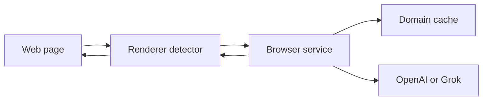

# Khromium

Khromium is an open-source Chromium fork with an opt-in classifier for anti-adblock walls and obfuscated ad overlays. The rest of this tree is upstream Chromium under the BSD license in `LICENSE`. The Khromium additions use that same license.

The classifier calls either the OpenAI API or xAI's Grok API. Both are OpenAI-compatible chat completions. The provider is switchable. The feature is off until you pass `--enable-features=KhromiumAiAdShield` or turn on `chrome://flags/#khromium-ai-ad-shield`.



## Read this first

- [Architecture and limitations](docs/khromium/architecture.md)
- [Environment setup and how to rebase](docs/khromium/environment-setup.md)
- [Files to add or modify, and how to compile](docs/khromium/apply-patches.md)
- [Companion app](app/khromium_classifier/README.md)

## What was added

Browser process, asynchronous, key never logged and never sent to a renderer:

- `components/khromium/` — flag, system prompt, JSON parser, script markers, Mojo
- `chrome/browser/khromium/` — `SimpleURLLoader` client, profile cache, keyed service, URL loader throttle
- `chrome/renderer/khromium/` — `RenderFrameObserver`, DOM scan, cleanup

The hook sites in upstream files are listed in `docs/khromium/apply-patches.md`.

## Build

You need depot_tools, about 100 GB free, and the usual Chromium dependencies. Full steps are in `docs/khromium/environment-setup.md`.

```bash
gn gen out/Default
autoninja -C out/Default chrome
```

Try the classifier without compiling Chromium:

```bash
cd app/khromium_classifier
python3 -m unittest discover -s tests -v
python3 -m khromium_classifier serve --port 8765
```

## Limitations

Sending a trimmed DOM snippet to a third-party model has privacy, latency, and cost consequences. The per-domain cache avoids repeat calls. The first visit to a domain still waits on the network. Details are in the architecture doc.

#  Chromium

Chromium is an open-source browser project that aims to build a safer, faster,
and more stable way for all users to experience the web.

The project's web site is https://www.chromium.org.

To check out the source code locally, don't use `git clone`! Instead,
follow [the instructions on how to get the code](docs/get_the_code.md).

Documentation in the source is rooted in [docs/README.md](docs/README.md).

Learn how to [Get Around the Chromium Source Code Directory
Structure](https://www.chromium.org/developers/how-tos/getting-around-the-chrome-source-code).

For historical reasons, there are some small top level directories. Now the
guidance is that new top level directories are for product (e.g. Chrome,
Android WebView, Ash). Even if these products have multiple executables, the
code should be in subdirectories of the product.

If you found a bug, please file it at https://crbug.com/new.
