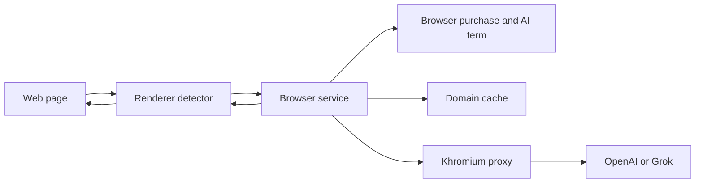

# Khromium

Khromium is a Chromium fork with **Khromium Shield**, a paid, closed-source classifier for anti-adblock walls and obfuscated ad containers. The rest of this tree is still upstream Chromium under the BSD license in `LICENSE`. Shield's own code is under `LICENSE.khromium` and is not open source.

Two paid offers: a one-time browser purchase (default **$49**, includes 30 days of AI) and a monthly AI plan priced at twice the configured API cost (default placeholder **$10/month**, which is 2 × $5). Khromium holds the OpenAI or xAI key on its proxy. Customers do not paste a provider key. The feature flag alone does not unlock AI.



## Read this first

- [Architecture and limitations](docs/khromium/architecture.md)
- [Environment setup and rebase workflow](docs/khromium/environment-setup.md)
- [Chromium files to add or modify](docs/khromium/hooks.md)
- [Browser purchase, monthly AI, and license keys](docs/khromium/commercial.md)
- [Companion app](app/khromium_classifier/README.md)
- [Download site](app/khromium_site/README.md)

## Apply and compile

The Shield sources are already in this checkout at their Chromium paths:

- `components/khromium/`
- `chrome/browser/khromium/`
- `chrome/renderer/khromium/`

Hook sites are listed in `docs/khromium/hooks.md`. Build with depot_tools:

```bash
gn gen out/Default
autoninja -C out/Default chrome
```

You need 100 GB or more free. Full steps, `args.gn`, and per-OS dependencies are in `docs/khromium/environment-setup.md`.

Run the paid companion without compiling Chromium:

```bash
cd app/khromium_classifier
python3 -m unittest discover -s tests -v
python3 -m khromium_classifier serve --port 8765
```

The download page takes payment with Stripe Checkout, then shows the license key:

```bash
cd app/khromium_site
python3 -m unittest discover -s tests -v
python3 -m khromium_site --port 8787
```

## Limitations

Sending a trimmed DOM snippet to a third-party model has privacy, latency, and cost consequences. The per-domain cache avoids repeat calls. Details are in the architecture doc.

#  Chromium

Chromium is an open-source browser project that aims to build a safer, faster,
and more stable way for all users to experience the web.

The project's web site is https://www.chromium.org.

To check out the source code locally, don't use `git clone`! Instead,
follow [the instructions on how to get the code](docs/get_the_code.md).

Documentation in the source is rooted in [docs/README.md](docs/README.md).

Learn how to [Get Around the Chromium Source Code Directory
Structure](https://www.chromium.org/developers/how-tos/getting-around-the-chrome-source-code).

For historical reasons, there are some small top level directories. Now the
guidance is that new top level directories are for product (e.g. Chrome,
Android WebView, Ash). Even if these products have multiple executables, the
code should be in subdirectories of the product.

If you found a bug, please file it at https://crbug.com/new.
