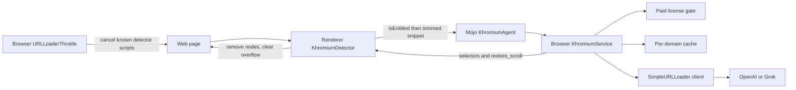

# Khromium Shield architecture

Khromium Shield is a paid add-on inside this Chromium fork. It watches for anti-adblock walls and obfuscated ad containers, asks OpenAI or xAI Grok about a trimmed snippet, and hides the elements the model names.



1. The main-frame renderer observer loads.
2. It asks the browser whether this profile has a paid subscription.
3. If not, it stops. No DOM is sent anywhere.
4. If yes, an isolated-world script collects a short JSON snippet: fixed high-`z-index` overlays, "disable your ad blocker" text, bait class names, and known detector scripts.
5. The browser drops the call unless the feature flag, the pref, and the license all pass. It then returns a cached decision when the registrable domain was seen inside the TTL.
6. Otherwise `AiClient` POSTs to `https://api.openai.com/v1/chat/completions` or `https://api.x.ai/v1/chat/completions`. The provider comes from `khromium.provider` or `ai_config.json` (`openai` or `grok`).
7. `ParseChatCompletionBody` reads `choices[0].message.content` with `base::JSONReader` and rejects selectors that contain angle brackets or `javascript:`.
8. The renderer removes the selectors and restores scrolling.
9. Separately, while the license is active, script requests whose URLs contain the markers in `script_patterns.h` are cancelled in the browser.

The system prompt forces this object and nothing else:

```json
{"block": true, "selectors": ["#ab-modal"], "restore_scroll": true, "reason": "anti-adblock wall"}
```

The same prompt is in `components/khromium/system_prompt.cc` and `app/khromium_classifier/khromium_classifier/prompt.py`.

## Limitations

- Page text leaves the machine. A trimmed snippet is sent to OpenAI or xAI when the cache misses. That is a privacy and compliance decision, not just a code decision. Do not enable the feature on profiles that must not leave the device.
- The round trip adds latency on the first visit to a domain. Later visits in the TTL do not call the API. The cache does not make the first visit free.
- Each cache miss costs whatever the chosen model charges. The companion app's default path is local heuristics so experiments do not spend credits.
- The model can name the wrong node or miss an overlay. Selectors are filtered, but they are not a formal proof.
- Client-side license checks can be patched out of a binary. Use `KHROMIUM_LICENSE_SERVER` if you need revocation. See [commercial.md](commercial.md).
- This is not a replacement for a filter list. `subresource_filter` is still the right layer for bulk ad URLs.
