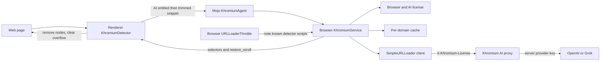

# Khromium Shield architecture

Khromium Shield is a paid add-on inside this Chromium fork. It watches for anti-adblock walls and obfuscated ad containers. While AI is entitled, the browser asks the Khromium proxy about a trimmed snippet. The proxy calls OpenAI or xAI Grok with the server key. The renderer hides the elements the model names. A one-time browser purchase stays valid after the 30-day AI trial ends; the model call does not.



1. The main-frame renderer observer loads.
2. It asks the browser whether AI protection is entitled (`ai_until` still in the future). A browser purchase whose 30-day trial has ended is not enough.
3. If AI is not entitled, it stops. No DOM is sent anywhere. The browser purchase can remain valid.
4. If AI is entitled, an isolated-world script collects a short JSON snippet: fixed high-`z-index` overlays, "disable your ad blocker" text, bait class names, and known detector scripts.
5. The browser drops the call unless the feature flag, the pref, and AI entitlement all pass. It then returns a cached decision when the registrable domain was seen inside the TTL.
6. Otherwise `AiClient` POSTs to `KHROMIUM_AI_PROXY_URL` (default `http://127.0.0.1:8766/v1/chat/completions`) with the license in `X-Khromium-License`. It does not send `KHROMIUM_OPENAI_API_KEY` or `KHROMIUM_XAI_API_KEY`. The proxy checks AI entitlement and calls OpenAI or xAI with the server key. `KHROMIUM_ALLOW_BYO_KEY=1` is a dev-only direct call, off by default.
7. `ParseChatCompletionBody` reads `choices[0].message.content` with `base::JSONReader` and rejects selectors that contain angle brackets or `javascript:`.
8. The renderer removes the selectors and restores scrolling.
9. Separately, while AI is entitled, script requests whose URLs contain the markers in `script_patterns.h` are recorded in the browser. The load is not cancelled. When the trial or monthly plan ends, the throttle stops.

The system prompt forces this object and nothing else:

```json
{"block": true, "selectors": ["#ab-modal"], "restore_scroll": true, "reason": "anti-adblock wall"}
```

The same prompt is in `components/khromium/system_prompt.cc` and `app/khromium_classifier/khromium_classifier/prompt.py`.

## Limitations

- Page text leaves the machine. A trimmed snippet is sent to the Khromium proxy, which calls OpenAI or xAI, when the cache misses and AI is entitled. That is a privacy and compliance decision, not just a code decision. Do not enable the feature on profiles that must not leave the device.
- The round trip adds latency on the first visit to a domain. Later visits in the TTL do not call the API. The cache does not make the first visit free.
- Each cache miss costs whatever the chosen model charges. The monthly customer price is twice that configured API cost. The companion app's default path is local heuristics so experiments do not spend credits.
- The model can name the wrong node or miss an overlay. Selectors are filtered, but they are not a formal proof.
- Client-side license checks can be patched out of a binary. Use `KHROMIUM_LICENSE_SERVER` if you need revocation. Browser entitlement and AI entitlement are separate. See [commercial.md](commercial.md).
- This is not a replacement for a filter list. `subresource_filter` is still the right layer for bulk ad URLs.
