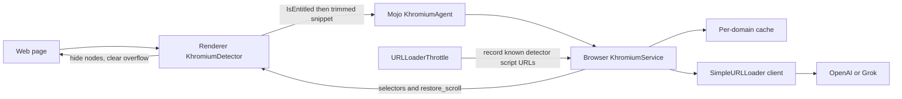

# Khromium architecture

Khromium adds an opt-in classifier for anti-adblock walls and obfuscated ad overlays. The renderer finds candidates. The browser process calls OpenAI or xAI Grok at most once per registrable domain, then the renderer hides the elements the model names and restores scrolling.



1. `KhromiumDetector`, a `content::RenderFrameObserver`, runs on the main frame after `DidFinishLoad` when `KhromiumAiAdShield` is enabled.
2. It asks the browser `IsEntitled()`. That answer is the feature flag plus the profile pref. It is not a subscription check. The API key never enters the renderer.
3. An isolated-world script scans the DOM and installs a short-lived `MutationObserver` (12 seconds) so overlays inserted just after load are still seen. C++ runs the scan again two seconds later and reads what the observer stored on the isolated-world global.
4. The snippet is a few kilobytes: fixed or high-`z-index` overlays, phrases such as "disable your ad blocker", bait class names, and known detector script URLs. Ordinary pages return an empty string and never call Mojo.
5. `KhromiumService` ignores the call unless the flag and pref are on and the committed URL is `http` or `https`. The cache key is `net::registry_controlled_domains::GetDomainAndRegistry` of the **committed** URL, not a URL inside the snippet.
6. A cache hit returns immediately. Concurrent calls for the same domain share one in-flight request.
7. `AiClient` POSTs with `network::SimpleURLLoader` and the profile `SharedURLLoaderFactory`. The callback runs later. The UI thread is not blocked. The provider is OpenAI (`https://api.openai.com/v1/chat/completions`, model `gpt-4o-mini`) or Grok (`https://api.x.ai/v1/chat/completions`, model `grok-3-mini`).
8. `ParseChatCompletionBody` reads `choices[0].message.content` with `base::JSONReader`. Unsafe selectors are dropped. A `block: true` reply with no safe selector becomes `block: false`.
9. The renderer hides up to eight matching elements (`display: none`) and, when asked, sets `overflow` and `overflow-y` to `visible` on `html` and `body`.
10. `AntiAdblockThrottle` records script URLs that contain the markers in `script_patterns.h`. It does not cancel or defer the load. Those URLs are appended to the next snippet for that domain.

The system prompt forces this object and nothing else:

```json
{"block": true, "selectors": ["#ab-modal"], "restore_scroll": true, "reason": "anti-adblock wall"}
```

The same text is in `components/khromium/system_prompt.cc` and `app/khromium_classifier/khromium_classifier/prompt.py`.

## Which layer, and why

**DOM work belongs in the renderer, not in a Blink core patch.**

An anti-adblock wall is computed style and text: `position: fixed`, a high `z-index`, `overflow: hidden` on `html` or `body`, and copy such as "disable your ad blocker". None of that is on the URL. Patching `third_party/blink/renderer/core/dom/mutation_observer.cc` would run on every mutation in every document and would rebase constantly.

`content::RenderFrameObserver::DidFinishLoad` plus `WebLocalFrame::RequestExecuteScript` in `ISOLATED_WORLD_ID_CHROME_INTERNAL` is the stable hook. The page script's `MutationObserver` is the short-lived equivalent of a Blink observer, and it dies after 12 seconds. Reusing the existing Chrome isolated world avoids shifting `ISOLATED_WORLD_ID_EXTENSIONS`, which would renumber extension worlds.

**The model call belongs in the browser process.**

Renderers are untrusted and multi-process. `network::SimpleURLLoader` with the profile `SharedURLLoaderFactory` is the supported async client. The key is loaded from `KHROMIUM_OPENAI_API_KEY`, `KHROMIUM_XAI_API_KEY`, or a JSON file under the profile or user data directory. It is an `Authorization` header. It is not logged, not written into the cache, and not a Mojo field.

**Network observation belongs in a browser `URLLoaderThrottle`, not in `subresource_filter`.**

`ChromeContentBrowserClient::CreateURLLoaderThrottles` sees script URLs for the page. That is the right place to notice `fuckadblock.js` and similar names. Cancelling those requests is the wrong action: many kits treat a blocked script as proof of an ad blocker. The throttle only records the URL.

`components/subresource_filter` is a ruleset engine for ad and tracking URLs (`ContentSubresourceFilterThrottleManager`). It does not see overlay text and it cannot clear `overflow: hidden`. Khromium does not hook it. It remains the right layer if you later want a compiled ad-URL list.

**Cleanup stays a page script.**

The browser returns selectors. The renderer applies them. `html` and `body` are never the hide target.

## Cache

`chrome/browser/khromium/analysis_cache.cc` stores one decision per registrable domain, including private suffixes such as `blogspot.com`, in `<profile>/khromium/analysis_cache.json`. The default TTL is 7 days (`khromium.cache_ttl_hours`). A failed model call is cached too, so a dead endpoint is not retried on every navigation. A missing API key is not cached. Disk reads and writes go through `base::ThreadPool` with `MayBlock()`.

## Limitations

- A trimmed snippet leaves the machine. Visible text and selectors are sent to OpenAI or xAI on a cache miss. That is a privacy decision. Do not enable the feature on a profile that must not leave the device. The snippet is capped around 12 KB and is not the whole DOM, but it can still contain personal page content.
- The first visit to a domain waits on a network round trip before anything is hidden. Later visits inside the TTL do not call the API. The cache does not make the first visit free of latency.
- Each cache miss costs whatever the chosen model charges. The companion app defaults to local heuristics so experiments do not spend credits.
- The model can name the wrong node or miss a wall that is drawn in canvas, shadow DOM, or an image. Selectors are filtered. They are not a proof.
- Heuristics false-positive on some consent dialogs and false-negative on walls that avoid the phrase list. The model is asked to return `block: false` for cookie banners, newsletter popups, and login walls.
- Hiding a node can break a site that expects it to stay in the tree. The cleanup hides at most eight elements and refuses `html` and `body`.
- This is not a substitute for a filter list.
